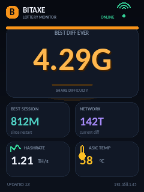

# Bitaxe Monitor — CYD 2.8" / NMMiner v2

Standalone monitor for **Bitaxe Gamma** (AxeOS) on the **ESP32-2432S028R**
(CYD 2.8", NMMiner v2) display, in 240×320 portrait or 320×240 landscape, with touch.



## Features

- **Best Diff Ever** in large type, with a Bitcoin-orange glow.
- **Best Session** and **network difficulty** in secondary cards.
- **Hashrate** (1-minute average) and **ASIC temperature**.
- **Multiple Bitaxe miners** (up to 8): maximum best ever/session, combined
  hashrate, and average temperature of online miners.
- **Global Hashrate** page: combined 1-minute average across all online miners.
- **Miners** page: per-miner online state, 1-minute hashrate, temperature, power, and IP.
- **Stats** page: total power, efficiency, accepted/rejected shares, and uptime.
- **History** page: 10-minute sparklines for hashrate and temperature.
- Seven touch pages: **Dashboard**, **Best Ever**, **Best Session**, **Hashrate**,
  **Miners**, **Stats**, and **History**. Tap to go to the next page; horizontal
  swipe navigates both ways.
- **Best Ever**, **Best Session**, and **Global Hashrate** values enlarged on
  their dedicated pages.
- **Portrait / landscape** orientation and **180° rotation** configurable from the web page.
- **Brightness** adjustable from 0 to 100% on the web page (PWM on GPIO21).
- **Night mode**: lower brightness during a configurable UTC window (NTP is
  configured automatically after Wi-Fi connects).
- **Screen timeout**: optional blanking after inactivity, wake on touch.
- **Offline alert**: large red exclamation mark and `BITAXE OFFLINE` / `WIFI OFFLINE`.
- **New best diff ever**: full-screen value blinking between dark-red/white and
  white/red until the screen is touched.
- **New session record**: white background with dark-blue `NEW!`, shown for 2 s,
  then 0.4 s of white, then 2 s again.
- **RGB LED**: blinks for 2 s on a new record, selectable best ever / best session / both.
- Status bar: online / miner offline / no Wi-Fi + signal level.
- Footer: last update age and monitor IP.
- **BLOCK FOUND** screen for a new block.
- **BitaxeMonitor** captive portal on first boot (WiFiManager), with a QR code
  to join the access point from a phone.
- Local web page to change the Bitaxe IP list, refresh interval, orientation,
  rotation, brightness, LED mode, night mode, screen timeout, and the screen page.
- **Web OTA updates**: upload the application image from the browser after the
  first full flash.
- **BOOT** long press for 5 s: erase Wi-Fi + settings and reboot.
- Multiple binaries for display variants (ST7789 RGB/BGR/inverted, ILI9341).

## Hardware

- ESP32-2432S028R / NMMiner v2, 2.8" 240×320 display.
- **ST7789** panel by default; an **ILI9341** variant is provided.
- Backlight on GPIO21 (LEDC PWM), display on SPI HSPI.
- **XPT2046** touch controller on a separate SPI bus: CS 33, IRQ 36, CLK 25,
  MOSI 32, MISO 39.
- Onboard RGB LED, active low: red GPIO4, green GPIO16, blue GPIO17.
- USB 5 V power.

## Build

Requirements: [PlatformIO](https://platformio.org/) (CLI or VS Code extension).

```bash
pio run                 # default target: cyd-st7789
pio run -e cyd-st7789-rgb
pio run -e cyd-st7789-inv
pio run -e cyd-ili9341
```

The merged images and application-only images are generated in `firmware/`:

- `bitaxe-monitor-<env>.bin`: full image to flash at **0x0**.
- `bitaxe-monitor-<env>-app.bin`: application-only image to flash at **0x10000**,
  or to upload from the OTA page.

The firmware uses the `min_spiffs.csv` partition table with two OTA application
slots. Build artifacts are not committed to Git. Use the prebuilt binaries from
the GitHub Releases page, or build them locally.

## Flash

### First flash (full image)

The full image is required once to install the OTA partition table. With
`esptool.py`:

```bash
esptool.py --chip esp32 --port /dev/ttyUSB0 --baud 921600 \
  write_flash 0x0 firmware/bitaxe-monitor-cyd-st7789.bin
```

On Windows, replace `/dev/ttyUSB0` with `COM3` (or the actual port).

With PlatformIO:

```bash
pio run -e cyd-st7789 -t upload
```

### Application-only update (USB)

```bash
esptool.py --chip esp32 --port /dev/ttyUSB0 --baud 921600 \
  write_flash 0x10000 firmware/bitaxe-monitor-cyd-st7789-app.bin
```

This does not change the partition table. Use the full image once if OTA is not
installed yet.

## OTA updates

After the first full flash, the monitor can update itself from the browser:

1. Open `http://<monitor-ip>/update`.
2. Select the `bitaxe-monitor-<env>-app.bin` file.
3. Upload: the monitor writes the inactive OTA slot and reboots automatically.

Use the **application-only** image (`*-app.bin`), never the full merged image.
NVS settings (Wi-Fi, IP list, display, LED, night mode) are preserved. If the upload is
interrupted, the previous firmware remains bootable; retry or flash by USB.

The OTA upload has no authentication. Use it only on a trusted local network.

## First boot

1. Flash the full image.
2. The monitor creates the open **`BitaxeMonitor`** access point.
3. Scan the QR code on the configuration page, or connect to the
   `BitaxeMonitor` Wi-Fi manually, then open **http://192.168.4.1**.
4. Enter the local Wi-Fi, the **Bitaxe IP list** (comma-separated), the refresh
   interval, orientation, rotation, brightness, and LED mode.
5. Save: the monitor joins the Wi-Fi network and displays the dashboard.

The default Bitaxe IP is `192.168.1.100`. Up to 8 miners can be monitored. If no
Bitaxe is reachable, the main value shows a `BITAXE OFFLINE` alert; the status
bar shows `NO MINER` with a single miner (`0/N` with multiple miners), and the
footer shows `MINER OFFLINE`. If Wi-Fi is lost, the screen shows `NO WIFI` and
the `WIFI OFFLINE` alert.

## Local web page

Once the monitor is on the network, open `http://<monitor-ip>/`.

- `/`: form for the Bitaxe IP list, refresh interval, orientation, rotation,
  brightness, LED mode, night mode, and screen timeout. Buttons at the top switch
  the display page.
- `/page?p=0`: switch the display to **Dashboard**.
- `/page?p=1`: switch the display to **Best Ever**.
- `/page?p=2`: switch the display to **Best Session**.
- `/page?p=3`: switch the display to **Global Hashrate**.
- `/page?p=4`: switch the display to **Miners**.
- `/page?p=5`: switch the display to **Stats**.
- `/page?p=6`: switch the display to **History**.
- `/save` (POST): save settings directly. Fields include `ips`, `poll`, `orient`,
  `flip`, `bright`, `led`, `night`, `nstart`, `nend`, `nbright`, and `timeout`.
- `/status`: JSON monitor state, including display, night, and per-miner `miners`
  details.
- `/update`: firmware update page (upload the `*-app.bin` image).
- `/restart`: restart the monitor.

Display settings are applied immediately, without a reboot.

## Display variants

| Environment | Binary | Driver | Colors | Inversion |
|---|---|---|---|---|
| `cyd-st7789` | `bitaxe-monitor-cyd-st7789.bin` | ST7789 | BGR | off |
| `cyd-st7789-rgb` | `bitaxe-monitor-cyd-st7789-rgb.bin` | ST7789 | RGB | off |
| `cyd-st7789-inv` | `bitaxe-monitor-cyd-st7789-inv.bin` | ST7789 | BGR | on |
| `cyd-ili9341` | `bitaxe-monitor-cyd-ili9341.bin` | ILI9341 | — | — |

If colors are inverted, try `cyd-st7789-inv`. If red and blue are swapped, try
`cyd-st7789-rgb`. If the screen stays black or shows artifacts, try `cyd-ili9341`.

## Defaults

| Setting | Value |
|---|---|
| Bitaxe IP list | `192.168.1.100` |
| Maximum miners | `8` |
| Refresh interval | `3 s` |
| Orientation | `portrait` |
| Rotation | `0°` |
| Brightness | `100 %` |
| LED mode | best ever + best session |
| Night mode | disabled |
| Night window | `22:00`–`07:00` UTC |
| Night brightness | `15 %` |
| Screen timeout | disabled |
| Captive portal | `BitaxeMonitor` |
| Portal timeout | `180 s` |
| Offline status | as soon as an AxeOS poll fails |
| Reset | hold BOOT for `5 s` |

## AxeOS API

```http
GET http://<bitaxe-ip>/api/system/info
```

Fields used: `bestDiff`, `bestSessionDiff`, `networkDifficulty`, `hashRate`,
`hashRate_1m`, `temp`, `power`, `sharesAccepted`, `sharesRejected`,
`blockHeight`, `blockFound`, `uptimeSeconds`.

`bestDiff`, `bestSessionDiff`, and `networkDifficulty` may be numeric or
suffixed strings (`4.29G`, `144.5T`). The firmware handles both formats.

## Security

- The local web page has **no authentication**: use it on a trusted local
  network and do not expose the monitor to the Internet.
- The OTA upload page is also unauthenticated and can replace the firmware:
  restrict access to the local network.
- The `BitaxeMonitor` portal is open by default (WiFiManager behavior).
- The BOOT reset erases Wi-Fi credentials and monitor settings.

## Troubleshooting

- **Black screen**: check the binary/driver, GPIO21 backlight, and try another variant.
- **`NO WIFI`**: the monitor is not connected to Wi-Fi; redo the portal or hold
  BOOT for 5 s to reset.
- **`NO MINER`**: Wi-Fi is OK but no AxeOS API is reachable; check the IP list
  from the local web page. The status bar shows `online/total` when multiple
  miners are configured.
- **Upside-down image**: use the local web page, select **180° rotation**, and
  save (no reflash needed).
- **Imprecise touch**: the firmware uses an approximate XPT2046 calibration
  (0..4095). Taps work across the surface; swipes may be less precise depending
  on the panel.
- **Black ILI9341 screen**: in `platformio.ini`, replace `ILI9341_2_DRIVER` with
  `ILI9341_DRIVER` in the `cyd-ili9341` environment.
- **Black ST7789 despite variants**: try `-D TFT_RST=4` or `-D TFT_RST=22` in
  the environment `build_flags`.
- **Night mode does not switch**: wait for NTP sync after Wi-Fi connects; the
  window is configured in UTC.
- **OTA upload rejected**: select the `*-app.bin` file, not the full merged image.
- **OTA failed**: the previous firmware remains bootable; retry, or flash the
  full image again by USB if the device no longer boots.
- **Serial logs**: `pio device monitor -b 115200`.

## Touch navigation

- **Dashboard**: main view (best ever, best session, network, hashrate, temperature).
- **Best Ever**: best diff ever in large type, full screen.
- **Best Session**: session best diff in large type, full screen.
- **Global Hashrate**: combined 1-minute average in large type, full screen.
- **Miners**: per-miner status cards.
- **Stats**: aggregate session and system statistics.
- **History**: 10-minute hashrate and temperature graphs.
- **Tap** anywhere: next page (Dashboard → Best Ever → Best Session → Hashrate →
  Miners → Stats → History → Dashboard).
- **Swipe left / right**: next / previous page.
- Dots at the bottom of the screen indicate the active page.

## Alerts and animations

- **BITAXE OFFLINE**: the AxeOS API no longer responds; a large red `!` replaces
  the main value and a red border surrounds the card.
- **WIFI OFFLINE**: the monitor lost Wi-Fi; same alert, different text.
- **New best diff ever**: full-screen `bestDiff` value alternates between a dark
  red background with white text and a white background with red text. It stays
  until a touch; if the record increases again, the displayed value updates and
  blinking continues. Only `bestDiff` triggers this overlay.
- **New session record**: white background and dark-blue `NEW!`, shown for 2 s,
  then 0.4 s of white, then 2 s again, when `bestSessionDiff` increases.
  The RGB LED blinks for 2 s according to the selected mode.
- **BLOCK FOUND**: 6-second full-screen animation when `blockFound` changes to 1.

## Releases

The GitHub Actions workflow builds all four display variants on pushes to
`main`/`master`, on tags, and on pull requests. To publish a release, push a tag:

```bash
git tag v1.2.0
git push origin v1.2.0
```

The workflow builds the firmware and attaches the `firmware/*.bin` files to the
GitHub release. Use the `*-app.bin` file for OTA updates and the full image for
the first USB flash. You can also build locally and upload the binaries manually.

## License

MIT. See [LICENSE](LICENSE).
